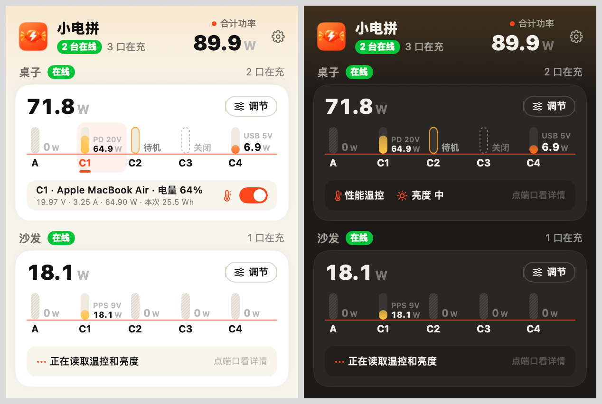
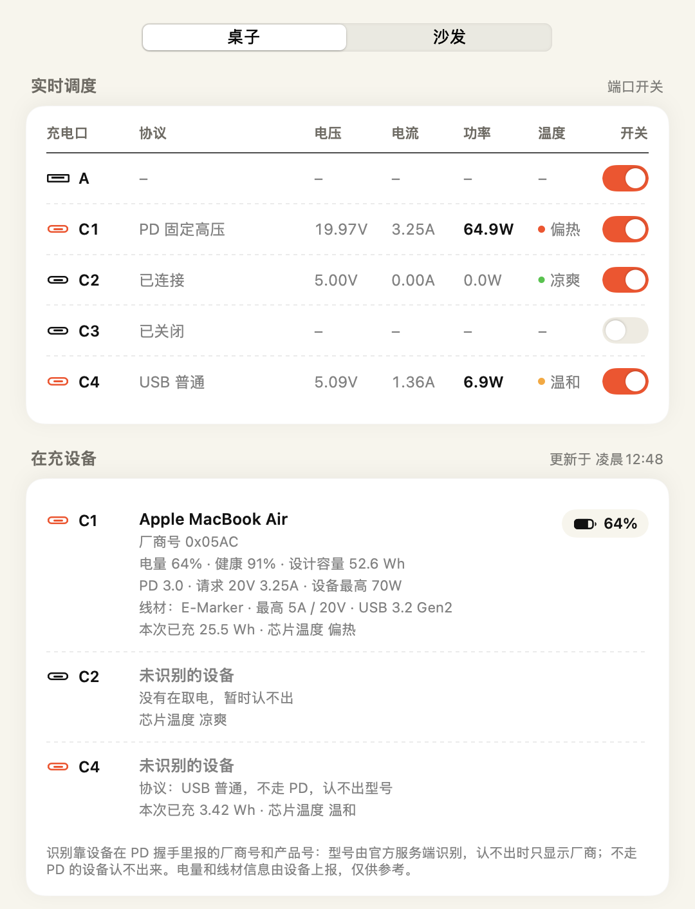
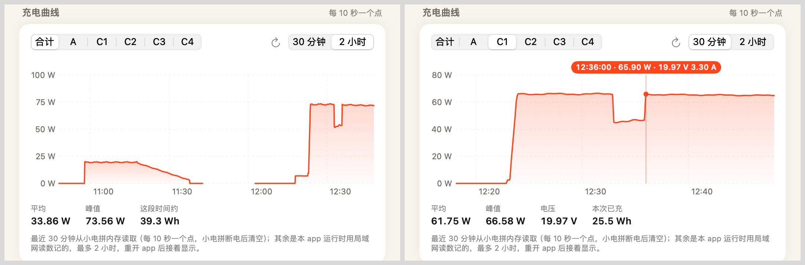
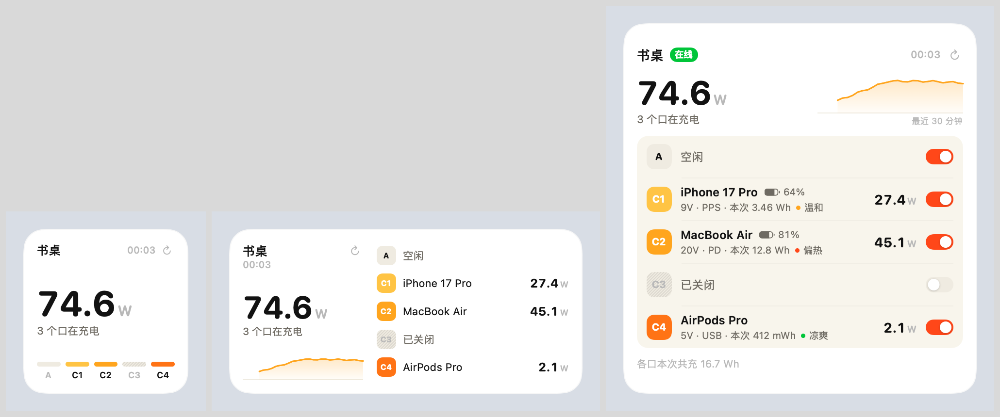
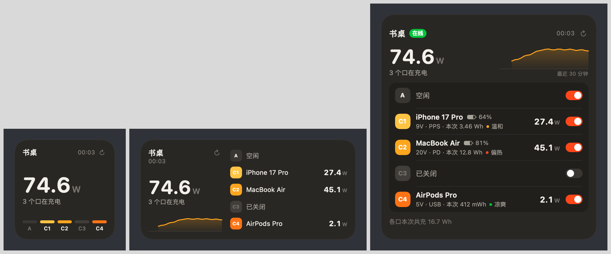
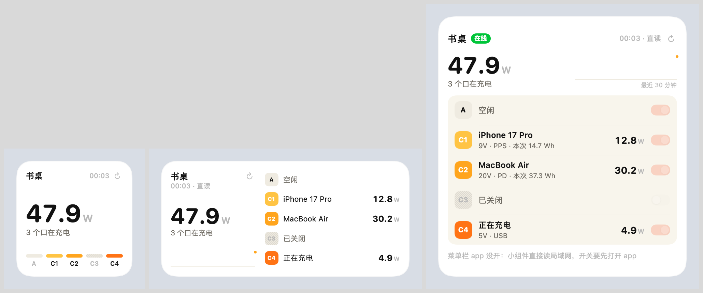

# CoCanBar (小电拼菜单栏)

[简体中文](README.md) | English

[](https://github.com/yangyihang96/CoCanBar/actions/workflows/ci.yml)

An unofficial macOS menu bar app for CANDYSIGN (制糖工厂) 小电拼 chargers (CP02 / CoCan). It is a third-party tool, not affiliated with or endorsed by CANDYSIGN. The interface is in Simplified Chinese; Chinese labels are quoted below with an English gloss.

- **Readings**: the LAN endpoint `http://<charger>/metrics.json`, read every few seconds, no login needed.
- **Control**: the official MCP (`mcp.thecandysign.com`). The MCP URL contains a token and is stored only in the Keychain.
- **Identification**: what is connected to each port, battery level, PD profile and cable, read with read-only tools of the official MCP. See "Device identification".
- **Temperature, energy, curves**: each port's chip temperature level, energy delivered in the current session, and power curves for the last 30 minutes to 2 hours (still there after relaunching the app). See "Chip temperature, session energy and charging curves".
- **Desktop widget**: small, medium and large, can show any of your chargers, with a refresh button; reads the LAN by itself while the menu bar app isn't running; the large size can switch ports. See "Desktop widget".
- **Shortcuts**: get power and status, switch ports, change the charging strategy, thermal mode and display brightness. See "Shortcuts".

Product and company names are trademarks of their respective owners.

## Screenshots

All screenshots use demo data.

The menu bar panel, light and dark. With a port selected, the detail strip shows the recognized device, battery level, session energy and chip temperature:



Live dispatch table and connected devices on the Adjust tab of the settings window:



Charging curves. Left: all ports combined over 2 hours; the break is a period without records (app not running or charger offline). Right: one port over 30 minutes, with the reading under the pointer:



Desktop widget in small, medium and large:





While the menu bar app isn't running, the widget reads the LAN by itself; the reading time is marked 「直读」 (direct) and the switches are greyed out:



## Interface

Styled after the 「电控」 (power control) page of the official WeChat mini program: cream background, white cards, orange-red brand colour; follows the system light or dark appearance.

- **Menu bar**: a bolt plus the total power of all online chargers. The item has a fixed width, so it doesn't shift as readings change.
- **Panel**:
  - The top shows how many chargers are online and how many ports are charging; with several chargers it also shows the combined power.
  - One card per charger. Name and online status sit above the card; inside are the total power, the 「调节」 (Adjust) button, the charging chart and a detail strip.
  - The charging chart has one capsule bar per port. Bar height is the square root of the port's power as a fraction of that port's limit, and colours follow the current mode (the mini program's scene palette):
    - idle: diagonal hatching;
    - connected but not drawing power: outline;
    - off: dashed frame.
  - Each time the panel opens, the bars grow in one after another. There is no animation when Reduce Motion is on.
  - Clicking a port shows its protocol, voltage, current, power, charging time and session energy in the detail strip (allocated power when the energy can't be read), plus the chip temperature (thermometer icon) and the port's switch.
    When the connected device is recognized, the title becomes the device name and battery level; hovering shows the full identification, session energy, chip temperature and allocated power.
  - Turning off a port that is supplying power, and switching the charging strategy, both ask for confirmation in the detail strip first.
  - Cards have a fixed height. Changing readings, selecting a port or the confirmation bar never make the panel jump.
- **「调节」 (Adjust) menu** (top right of each card):
  - charging strategy (with icons and descriptions), thermal mode and display brightness (submenus);
  - 「端口开关、功率分配和全部调节…」 (port switches, power allocation and all settings…) opens the Adjust tab of the settings window.
- **Settings window**:
  - 调节 (Adjust):
    - live dispatch table: each port's protocol, voltage, current, power, chip temperature and switch;
    - connected devices: each port's device, battery level and health, PD profile, cable, session energy and chip temperature;
    - charging curve: one port or all ports combined, the last 30 minutes or 2 hours;
    - charging mode, thermal mode, display brightness;
    - port power allocation (temporary);
    - CP02S display options, when the charger reports support.
  - 设备 (Devices): name, PSN, host, MCP URL (stored in the Keychain), plus test connection, scan the LAN and delete charger.
  - 通用 (General): refresh interval, launch at login.

## What can be controlled

Every write operation of the official MCP is available in the app:

| Setting | MCP tool | Where |
| --- | --- | --- |
| Port on / off | `turn_on_port` / `turn_off_port` | Panel detail strip, Adjust tab |
| Charging strategy: 自由流 (free flow), 睡眠充 (sleep), 性能模式 (performance), 极速单充 (fast single port) | `set_charging_strategy` (0 / 1 / 7 / 8) | Adjust menu, Adjust tab |
| 魔拟充 (small-appliance mode) | `set_usba_charging_mode` | Adjust menu, Adjust tab |
| Thermal mode: 性能温控 (performance) / 安心温控 (cooler) | `set_temperature_mode` (0 / 1) | Adjust menu, Adjust tab |
| Display brightness: off / low / medium / high | `set_display_intensity` | Adjust menu, Adjust tab |
| Port power allocation (temporary) | `set_port_power_allocation` | Adjust tab |
| Status display mode, idle display, hourly chime (CP02S) | `set_status_display_mode` / `set_idle_display` / `set_hourly_chime` | Adjust tab, shown only when the charger reports support |

- Strategy names follow the mini program's 「模式」 (Mode) page.
  - 自由流 and 睡眠充 correspond to `FLEXAI_FAST` / `FLEXAI_SLOW`.
  - 睡眠充 = 1 follows the SLEEP → FLEXAI_SLOW mapping in the mini program's source.
- Thermal names follow the mini program: power first is 「性能温控」 (more performance), temperature first is 「安心温控」 (less heat).
- The mini program's 「苹果全家桶」 (Apple set) and 「自定义」 (custom) modes use static allocation tables that the MCP can't set, so they aren't here.
- Power allocation rules:
  - each port gets from 15 W up to its limit, or 0 (follow the strategy);
  - the total can't exceed the charger's limit, which is read from `get_machine_facts`;
  - according to the open-source firmware, applying it makes every port renegotiate; after any plug-in, unplug or port switch the charger returns to the strategy's allocation.

## Device identification

The 「在充设备」 (connected devices) list on the Adjust tab shows what each port is connected to; the panel's detail strip shows it too when a port is selected.

- The data comes from `get_port_pd_status` and `get_port_details` of the official MCP, both read-only.
  - The LAN `metrics.json` has no PD information on firmware 2.2.0, so chargers without an MCP URL show no identification.
- Model: the device reports a vendor ID (VID) and product ID (PID) during PD negotiation, and the official server returns the model.
  - When the server returns no model, the vendor is shown from the VID, using a built-in table of common phone, computer, console and accessory vendors.
  - VIDs of chip vendors aren't shown as brands.
  - A few devices (Apple, Samsung, Nintendo) report their VID only in the battery information; the battery's VID fills in then, following the mini program's rule.
- Battery level and health use the mini program's conversion and filtering rules.
  - Neither is shown when the design or full-charge capacity is outside 5–200 Wh, or when health is below 75%.
- PD: protocol revision, the voltage and current the device currently requests, the device's declared maximum power, and PPS / EPR support.
- Cable:
  - cables with an E-Marker show maximum current and voltage, USB speed, whether they're active, and EPR support;
  - cables the server knows show brand and model;
  - C-to-C cables without an E-Marker are limited to 3 A, per the PD specification.
- When it's read:
  - once after a plug-in or renegotiation (at least 5 seconds after the previous read), and again 20 seconds later, because devices often report everything only by then;
  - then once a minute, to update the battery level;
  - not while both the panel and the settings are closed, and the cloud isn't asked when nothing is connected.
- Devices that don't use PD (plain USB charging, QC and so on) can't be identified; only the protocol is shown.

## Chip temperature, session energy and charging curves

All of these need an MCP URL; every MCP tool they use is read-only.

- Chip temperature: `die_temperature` from `get_port_details`. The official MCP gives a level, not degrees.
  - Shown as 凉爽 (cool), 温和 (mild), 偏热 (warm) and 过热 (hot), coloured green, yellow, orange and red.
  - Mild and warm have been seen in testing, and cool appears in the PD status; hot (`hot`) is inferred from the naming and hasn't been seen.
  - Shown in the temperature column of the live dispatch table, in the connected devices list and in the panel's detail strip; not shown for empty ports.
- Session energy: the energy delivered since the device was plugged in.
  - `session_charge_mwh` from `get_port_details` is authoritative and is read together with identification.
  - Between reads it's extrapolated from the increase of the LAN `session_charge`, so the number moves with the readings every few seconds.
  - `session_charge` isn't in mWh. On a CP02 Pro (firmware 2.2.0) the ratio over four sessions was 146,617–148,553 per mWh;
    checked against integrated power with a steady 5.4 W load, it was off by about 5%. The ratio is calibrated live from MCP readings every time; the measured value 146,600 is used only when calibration isn't possible.
  - After unplugging and plugging in again the session number changes, and the old reading is no longer shown.
- Charging curve (Adjust tab of the settings window):
  - Power of one port or of all ports combined, the last 30 minutes or 2 hours, one point every 10 seconds. It opens on the charging port with the highest power.
  - The last 30 minutes are read from the charger's memory (`get_port_stats`): the firmware stores one 10-second average at a time, at most 180, cleared on power loss.
    It's read once when the curve opens and not again within 5 minutes; the refresh button reads it again.
  - Anything older was recorded by this app from LAN readings while it was running, up to 2 hours.
    - Saved to disk once a minute and on quit (including SIGTERM from `kill`), and shown again after relaunch; points older than 2 hours and records of removed chargers are dropped when loading.
    - When the charger's memory is read again, the part of the previous device data that is older than the new window is folded into the app's records, so it isn't lost.
  - Periods when the app wasn't running or the charger was offline stay as gaps instead of being joined by a slanted line. Gaps while the app was closed that are still within the last 30 minutes are filled the next time the charger's memory is read.
  - Hovering over the curve shows the power at that moment; for a single port also the voltage and current.
  - Below the curve are the average (over periods with power only), peak, voltage range and session energy; in the combined view, roughly how much energy was delivered in the period.
  - `get_port_stats` points have no timestamps. They're laid out backwards on the assumption that the last one is the newest, so times can be off by a few seconds.
    The order was confirmed in testing: two reads 46 seconds apart shifted the series left by exactly 4 points.

## Desktop widget

Right-click an empty area of the desktop → 「编辑小组件」 (Edit Widgets), search for 小电拼, and drag it to the desktop or Notification Center. Right-click the widget → 「编辑“小电拼”」 to choose which charger it shows; without a choice it shows the first one.

- Small: charger name, reading time, total power, number of charging ports; at the bottom a status strip for the five ports (port colour when charging, a light groove when idle, hatching when off).
- Medium: adds the combined power trend of the last 30 minutes, with each port's device name and power on the right.
- Large: each port's device, battery level, power, voltage, protocol, session energy, chip temperature and switch; the bottom shows the energy delivered across ports in their current sessions, or a notice.
  - Turning off a port in use takes two taps: the first turns the switch into a red 「关闭？」 (turn off?), and only a second tap within 10 seconds sends the command.
  - Chargers without an MCP URL show no switches. Switches are greyed out while the menu bar app isn't running, the charger is offline, the reading is stale or another operation is in progress.
- All three sizes have a refresh button at the top right.
- Colours match the panel; port colours follow the charging strategy this app last set.
- While the menu bar app is running:
  - The widget shows the snapshot the app writes. After reading LAN data the app writes at most every 10 seconds; it writes immediately when a switch, plug-in, online status or notice changes.
  - The system decides how often widgets refresh. For changes such as switches or plug-ins the app asks for a refresh at most every 30 seconds; for power-only changes at most every 5 minutes; and every 14 minutes even when nothing notable changed, so readings don't get marked as stale. After a switch is tapped on the widget, it refreshes as soon as the command finishes.
  - The refresh button asks the app to read the LAN right away, waits for the new snapshot (up to 3 seconds), then refreshes.
- While the menu bar app isn't running (no snapshot written for 1 minute, or it has quit), the widget reads the LAN by itself on each refresh:
  - It reads only the charger's home page and `metrics.json`. No token is needed, and the widget has no access to one.
  - It uses the host name the app last recorded and, if that can't be resolved or read, the IP the app last used. Each time it checks the PSN on the home page and shows nothing if a different charger answers.
  - It waits at most 10 seconds. After a successful read it reads again in about 5 minutes, after a failure in 15 minutes, and the system may push this back further. The refresh button reads again right away.
  - Within the same charging session (unchanged session number) the device name is kept and session energy continues from the increase of the LAN `session_charge`. Battery level and chip temperature are only available from the MCP and aren't shown.
  - The reading time is marked 「直读」 (direct), and the large size says at the bottom that the app isn't open; the trend only has the points the widget read itself.
  - Per Apple's TN3179, an extension shares the Local Network permission of the app that contains it: once the app is allowed, the widget can read.
  - When the app quits normally (including SIGTERM from `kill`), it first records that in the snapshot and then asks the system to refresh the widget, so there's no 1-minute wait.
- Every reading shows its time (24-hour clock). When it hasn't updated for more than 15 minutes, the time turns orange-red as 「停在 14:05」 (stopped at 14:05), and the large size suggests tapping refresh.
- How switch commands are sent:
  - The widget can't get the MCP token. When a switch is tapped, it writes a command (which charger, which port, on or off) to the shared folder and posts a notification to wake the menu bar app.
  - The app checks the command and sends it with the MCP URL from its own Keychain; the result is shown at the bottom of the widget.
  - The app executes only commands that were issued within the last 15 seconds, for a charger that has been added, has an MCP URL, is online and has that port.
  - Switches are greyed out while the app isn't running. If the app happens to quit unexpectedly and doesn't reply within 3 seconds, the widget withdraws the command and shows a notice; the app won't execute it when it opens later.
- The app has to be packaged with `scripts/build-app.sh` on a Mac with an Apple Development certificate: the app and the widget share data through an App Group. With ad-hoc signing the widget gets no data.

## Shortcuts

Search for 小电拼 in the Shortcuts app. The actions run in the menu bar app; the system opens it first if it isn't running.

| Action | Parameters | Result |
| --- | --- | --- |
| 读取小电拼功率 (get power) | Charger, port (both optional) | Power (watts, a number); the total of all ports when no port is chosen |
| 读取小电拼状态 (get status) | Charger | Text: each port's switch, power, voltage, protocol, recognized device, battery level, session energy and chip temperature |
| 开关小电拼端口 (switch port) | Charger, port, on or off, confirm before turning off a port in use | Completion message |
| 切换小电拼充电策略 (change charging strategy) | Charger, strategy, confirm before switching | Completion message |
| 设置小电拼温控 (set thermal mode) | Charger, 性能温控 or 安心温控 | Completion message |
| 设置小电拼屏幕亮度 (set display brightness) | Charger, off / low / medium / high | Completion message |

- Without a charger chosen, the first one is used.
- Readings go over the LAN, so the Mac has to be on the same network as the charger. Control goes through the official MCP and also works from other networks, but the MCP URL has to be set up in the app first.
- Both confirmations are on by default and ask first, as the panel does. They can be turned off for automations.
- Get power, get status, switch port and change charging strategy are also registered as App Shortcuts (「用小电拼读取功率」 and so on), so they can be found without building a shortcut.
- As with the widget, the app has to be packaged with `scripts/build-app.sh`: the actions' metadata is generated only by Xcode's build process.

## Building

Requires Xcode (verified with Xcode 27 / Swift 6.4 / macOS 27.2).

```bash
./scripts/build-app.sh
```

- The script builds Release from `CoCanBar.xcodeproj` (universal, Apple silicon and Intel), signs it and produces `build/小电拼.app`.
  - The widget extension and the Shortcuts metadata (`Metadata.appintents`) are produced only by Xcode's build process, so release builds aren't made with SwiftPM.
  - The project's four targets reference the matching folders under `Sources/` directly; adding source files doesn't require editing the project.
- It signs with this Mac's Apple Development certificate. The signing identity stays the same, so the Keychain keeps trusting the app after rebuilds.
  - If you don't have one yet, sign in with your Apple ID under Xcode › Settings › Accounts, select the team, click Manage Certificates… and add an Apple Development certificate. A free Apple ID works.
  - With several certificates, set the `CODESIGN_IDENTITY` environment variable (the certificate's SHA-1 or name) to choose one.
- The App Group is `<Team ID>.com.local.CoCanBar`, built from the certificate's Team ID and written into the entitlements files in `build/xcode/entitlements/`.
  - On macOS this form needs no provisioning profile.
  - The widget extension is sandboxed (a system requirement) and also gets the outgoing network entitlement (`com.apple.security.network.client`) for LAN reads while the app isn't running; its Info.plist also has the ATS local networking exception. The menu bar app isn't sandboxed.
  - Without a certificate the script falls back to ad-hoc signing: the app works, but the widget gets no data.
- The script checks that the app and widget version numbers match. When changing the version, change `Support/Info.plist` and `Support/Widget-Info.plist` together.
- After packaging it unregisters and deletes Xcode's intermediate products, so the same bundle ID isn't registered twice and Shortcuts and widgets don't pick up the unsigned copy.

Development, unit tests and offscreen snapshots use SwiftPM:

```bash
swift build
swift test
swift run CoCanBarWidget <directory>
```

- The last command renders the widget from demo data in all three sizes, light and dark, plus states such as pending turn-off, sent, app not running, direct LAN read while the app is closed, direct read failed, app just quit, no MCP, offline, stale reading and no data.
- SwiftPM debug builds have neither the App Group nor the Shortcuts metadata: widget sharing and Shortcuts don't work there, everything else does.

The icon artwork was generated by ChatGPT (Codex image generation) in the project's palette; the three candidates are in `Support/图标方案/`. To regenerate the icon after replacing the artwork:

```bash
xcrun swift scripts/make-icon.swift Support/AppIcon-source.png Support/AppIcon.icns
```

## First-time setup

1. Open `build/小电拼.app`. When the system asks for Local Network access, click Allow, or LAN readings won't work.
   - You can also turn it on later in System Settings › Privacy & Security › Local Network.
   - Per Apple's TN3179, the desktop widget uses the app's permission.
2. Open the panel, choose 「设置…」 (Settings…) from the gear at the top right, go to the 「设备」 (Devices) tab and add a charger in either of these ways:
   - paste the MCP URL copied from the mini program's 「MCP 指南」 (MCP guide); the PSN is detected from the URL;
   - or click 「扫描局域网」 (scan LAN) and add a discovered `cp02-<PSN>`. This gives readings only; for control, paste the MCP URL as well.

Chargers can also be imported in bulk with launch arguments. The app extracts every official MCP URL from the file and stores them in the Keychain:

```bash
open build/小电拼.app --args --import <file containing MCP URLs> --rename <PSN>=Sofa
```

## Data and security

- The charger list (names, PSNs, hosts) is stored in `UserDefaults` (`com.local.CoCanBar`), without secrets.
- MCP URLs are stored in the login Keychain as generic passwords, with the service name `com.local.CoCanBar.mcp` and the PSN as the account.
- Only URLs of the form `https://mcp.thecandysign.com/<PSN>/<token>/mcp` are accepted, so the token is never sent to another host.
- MCP requests don't follow redirects; a 3xx response is treated as an error.
- The interface shows URLs only with the token removed. Error messages don't include URLs, and error text returned by the server is redacted before it's shown.
- LAN readings verify the charger's identity:
  - The host name is resolved again every minute.
  - When the IP changes, or a minute has passed, the PSN on the charger's home page is checked.
  - When a different charger answers at the address, its readings aren't shown, so you don't switch ports based on the wrong charger's state.
- The LAN interface itself has no authentication; any device on the same network can read it. That's the firmware's behaviour, not something this app adds.
- The widget's data lives in the App Group container `~/Library/Group Containers/<Team ID>.com.local.CoCanBar/`:
  - `snapshot.json`: charger names, PSNs, host names and the LAN IP the app last used, online status, per-port readings and session numbers, and the session energy ratio; no MCP URLs or tokens.
  - `lan/<PSN>.json`: what the widget read by itself while the app wasn't running, one file per charger.
  - `commands/`, `replies/`: switch commands from the widget and the app's replies, deleted once handled.
  - `pending.json`, `notice.json`: the widget's own pending confirmation and notices.
- The widget extension is sandboxed and has outgoing network access, used only to read the charger's home page and `metrics.json` on the LAN while the app isn't running (checking the PSN as the app does).
  It doesn't read the Keychain, and there's no token in the shared folder, so it can't make MCP requests.
- Charging curve records are stored in `~/Library/Application Support/com.local.CoCanBar/history.json`: time, power, voltage and current for each port, grouped by PSN, at most 2 hours, no MCP URLs.
- Switch commands expire after 15 seconds, and the app checks each one before sending it; only ports that exist on chargers that have been added, have an MCP URL and are online can be switched.
  Any program that can write to the shared folder as you can also put commands there, with the same limits: it can only switch those ports, and gets neither the token nor control of other chargers.

## Probe tool

Checks readings and the MCP without the interface:

```bash
swift build --product cocan-probe
.build/debug/cocan-probe lan cp02-<PSN>.local
.build/debug/cocan-probe lan-check <PSN>
.build/debug/cocan-probe scan
.build/debug/cocan-probe mcp <file containing the MCP URL> <PSN>
.build/debug/cocan-probe mcp <file containing the MCP URL> <PSN> --schema
.build/debug/cocan-probe mcp <file containing the MCP URL> <PSN> get_charging_status
.build/debug/cocan-probe mcp <file containing the MCP URL> <PSN> --identify
.build/debug/cocan-probe mcp <file containing the MCP URL> <PSN> --history C1
```

- `lan-check` reads once the way the widget does while the app isn't running: it resolves `cp02-<PSN>.local` (a host name or IP can also follow the PSN), checks the PSN on the home page, then reads live data. It prints the total power, number of ports and time taken, without the PSN or address.
- `mcp` without a tool name lists the tools; `--schema` prints each tool's description and parameter schema; with a tool name it calls that tool.
- `--identify` identifies each port's device with the app's rules and prints the model, vendor ID, PD profile, battery level, cable, chip temperature and session energy for each port.
- `--history C1` prints how many points that port has in the charger's memory for the last 30 minutes, their time range, average and peak, and the last 6 points.
- Only read-only tools whose names start with `get_` are allowed by default; write operations such as switching ports or changing the strategy need `--allow-write`.

## Debugging (Debug builds only)

Checks the interface with demo data. Apart from `--live-window` at the end, these flags don't poll, read the Keychain or send requests:

```bash
swift build
.build/debug/CoCanBar --snapshot <directory>
.build/debug/CoCanBar --demo 1 --demo-window
```

- `--snapshot <directory>`: renders the panel for every scene offscreen, one light and one dark PNG each, then exits.
- `--demo <scene>`: runs the real panel with demo data. Scenes:
  1. normal;
  2. selection and strategy switch;
  3. turn-off confirmation and command in progress;
  4. offline and notices;
  5. errors while connecting, and read-only;
  6. no chargers.
- `--demo-window`: puts the panel in an ordinary window right below the main screen's menu bar. On recent macOS versions menu bar items are hosted by a system process, so a MenuBarExtra panel can't be opened from the program; an ordinary window shows the real rendering instead.
- `--demo-settings [devices|general]`: opens a settings page in another window, the Adjust tab by default.
- `--demo-menu`: opens the first card's 「调节」 menu once the window is up.
- `--demo-light`: light appearance; dark by default.
- `--demo-capture <directory>`: exports the demo window's content as a PNG at 4 and at 8 seconds.
- Charging curve:
  - `--demo-span 2h`: opens on the 2-hour view;
  - `--demo-curve-port <C1|A|合计…>`: opens on this port (合计 is the total);
  - `--demo-hover <minutes>`: behaves as if the pointer rests that many minutes back, to check the reading bubble.
- `--live-window`: uses real chargers instead of demo data and puts the panel in an ordinary window; can be combined with `--demo-settings` and the other flags above.
  - It polls chargers, reads the Keychain and calls the MCP like a normal run. Switches and buttons in the window are real and will control the charger.
  - To read MCP URLs from the Keychain, the debug binary has to be put into the same app bundle as the release build and signed with the same certificate; otherwise a Keychain access prompt appears.

## Known limitations

- The MCP has no tool for reading the current charging strategy. The panel shows the strategy "last set by this app".
- Chip temperature is a level only, without degrees.
- The LAN ratio for session energy is an empirical value that the firmware doesn't document; when the MCP can't be read, no energy is shown.
- Charging curves cover at most 2 hours. For periods when the app wasn't running, only the last 30 minutes can be filled in from the charger's memory; anything older has no record.
- The mini program's 「电量统计」 (energy statistics: today, daily peak, total) uses CANDYSIGN's own cloud API, and the MCP has no matching tool, so it isn't here.
- Control depends on the official cloud; without internet access only readings work.
- How `metrics.json` reports a port that has been turned off (the `active` / `state` values) hasn't been confirmed in testing. For now `INACTIVE` is treated as off, following the firmware source.
- CP02S display options haven't been tested on a real CP02S. The field names in `get_display_config` are undocumented and are currently recognized by their values.
- Power allocation behaviour is inferred from the open-source firmware source and hasn't been tested.
- Device identification:
  - Cable identification and PD profiles have been checked on a real CP02 Pro.
  - A device model returned by the server hasn't been seen yet: none of the tested devices reported a VID during PD negotiation.
    The model field names (`device_name_*`, `device_brand_*`) are inferred from the naming of the cable fields and from other open-source clients.
  - Battery level and health depend on what the device reports. Many devices don't report them, or report them inaccurately, so even after the mini program's filters they're only indicative.
  - Identification goes through the official cloud and isn't shown without internet access.
- Desktop widget:
  - The system decides when it refreshes and limits how often per day, so readings can lag behind the panel by a few minutes.
  - Switch commands have to be sent by the menu bar app. While the app isn't running, the widget can read the LAN by itself, but its switches are greyed out and battery level and chip temperature aren't shown.
    You can turn on 「登录时启动」 (launch at login) on the General tab of the settings.
  - Direct LAN reads by the widget while the app isn't running: the same read function has been checked on two real chargers with `cocan-probe lan-check`,
    but it hasn't run inside the real widget extension yet; that the extension inherits the app's Local Network permission is inferred from Apple's TN3179.
  - So far only offscreen snapshots have been checked, not each size on a real desktop; whether clicking the widget opens the app hasn't been checked either.
  - The widget's port switches and refresh button haven't been tested end to end on real hardware.
- Shortcuts: the actions are built into the app and registered with the system, but haven't been run in the Shortcuts app yet.

## Layout

```
Sources/CoCanKit/        networking, protocol, Keychain, data shared with the widget (no UI)
Sources/CoCanStyle/      palette and small shared UI pieces (used by the panel and the widget)
Sources/CoCanBar/        SwiftUI menu bar app (panel, charging chart, charging curve, settings, Shortcuts, widget data)
Sources/CoCanBarWidget/  desktop widget; when built with SwiftPM it's the offscreen snapshot tool
Sources/cocan-probe/     command-line probe
Tests/CoCanKitTests/     unit tests for parsing, validation, shared data, direct widget reads and curve persistence
Support/                 Info.plists for the app and widget (LSUIElement, Local Network usage text, ATS local exception), icon
CoCanBar.xcodeproj/      Xcode project for packaging (only it can produce the widget extension and Shortcuts metadata)
scripts/                 packaging and signing (build-app.sh), icon generation (make-icon.swift)
docs/screenshots/        screenshots used in the README (demo data)
.github/workflows/       CI: SwiftPM build and unit tests on every push
```

## License

MIT, see [LICENSE](LICENSE).
